  

  <a href="https://forkbomb.solutions"><b>forkbomb.solutions</b></a>
  &nbsp;·&nbsp; <a href="https://credimi.io">credimi.io</a>
  &nbsp;·&nbsp; <a href="https://didroom.com">didroom.com</a>
  &nbsp;·&nbsp; <a href="https://www.linkedin.com/company/forkbomb/">LinkedIn</a>
  &nbsp;·&nbsp; <a href="https://twitter.com/ForkbombEu">X</a>
  &nbsp;·&nbsp; <a href="mailto:info@forkbomb.eu">info@forkbomb.eu</a>

We build open-source software for the **European Digital Identity Wallet** and the **Digital Product Passport**, on a multiplatform cryptographic stack (Zencode on the Zenroom VM) that runs on servers, mobile, browsers and embedded chips, post-quantum ready. Founded in 2021 in Amsterdam as a spin-off of [Dyne.org](https://dyne.org).

## What we build

<table>
  <tr>
    <td width="50%" valign="top">
      <h3>Credimi</h3>
      
<b>EUDI Wallet conformance and interoperability.</b> Test wallets, credential issuers and verifiers together against OpenID4VCI, OpenID4VP and the EUDI FCAF, on real devices, and keep the evidence of every run.

      
<a href="https://credimi.io">credimi.io</a> · <a href="https://docs.credimi.io">Docs</a> · <a href="https://atlas.credimi.io">EUDI Atlas</a> · <a href="https://trust-inspector.credimi.io">Trust Inspector</a> · <a href="https://github.com/ForkbombEu/credimi">Repository</a>

    </td>
    <td width="50%" valign="top">
      <h3>DIDroom</h3>
      
<b>Open-source EUDI wallet stack.</b> Holder wallet and verifier apps for Android and iOS, OpenID4VCI and OpenID4VP issuer and verifier microservices, and an admin dashboard. SD-JWT VC, mDoc, W3C DID and VC, BBS+ and Coconut zero-knowledge credentials.

      
<a href="https://didroom.com">didroom.com</a> · <a href="https://github.com/ForkbombEu/wallet">Wallet</a> · <a href="https://github.com/ForkbombEu/verifier">Verifier</a> · <a href="https://github.com/ForkbombEu/DIDroom_microservices">Microservices</a>

    </td>
  </tr>
  <tr>
    <td width="50%" valign="top">
      <h3>Digital Product Passport</h3>
      
<b>Passports for complex supply chains.</b> Interfacer models products, materials and services on the ValueFlows ontology, identifies every actor with a W3C DID and anchors the passport on a blockchain so its history can be verified by third parties.

      
<a href="https://forkbomb.solutions/solution/interfacer-platform/">Interfacer</a> · <a href="https://github.com/interfacerproject/interfacer-dpp">interfacer-dpp</a> · <a href="https://github.com/interfacerproject/zenflows">zenflows</a>

    </td>
    <td width="50%" valign="top">
      <h3>Post-quantum and Zencode services</h3>
      
<b>Crypto as readable contracts and REST APIs.</b> Hybrid post-quantum cryptography on server, mobile and browser; Zencode and Slangroom contracts served as microservices with ncr and deployed on AWS or Google Cloud with OpenTofu.

      
<a href="https://forkbombeu.github.io/pqspread/">PQSpread demo</a> · <a href="https://pqc.api.forkbomb.eu/docs">PQC API</a> · <a href="https://github.com/ForkbombEu/ncr">ncr</a> · <a href="https://apiroom.net">Apiroom IDE</a>

    </td>
  </tr>
</table>

<b>See the full stack</b>: from the crypto core to EUDI Wallet conformance, with the repositories of each layer

 

  

  
    EU projects: <a href="https://forkbomb.solutions/project/we-build/">WE BUILD</a> · <a href="https://forkbomb.solutions/project/ebsi-pcp/">EBSI PCP</a> · <a href="https://forkbomb.solutions/project/decode/">DECODE</a> · <a href="https://forkbomb.solutions/project/reflow/">REFLOW</a> · <a href="https://forkbomb.solutions/project/interfacer/">INTERFACER</a> · <a href="https://forkbomb.solutions/project/closer/">CLOSER</a>
     
    Supported by <a href="https://trustchain.ngi.eu/">NGI TRUSTCHAIN</a> and <a href="https://ngisargasso.eu/">NGI Sargasso</a>
     
    Forkbomb B.V. · Haparandadam 7-A1, 1013AK Amsterdam · <a href="https://forkbomb.solutions/use-cases/">Work with us</a> · <a href="mailto:info@forkbomb.eu">info@forkbomb.eu</a>
  

